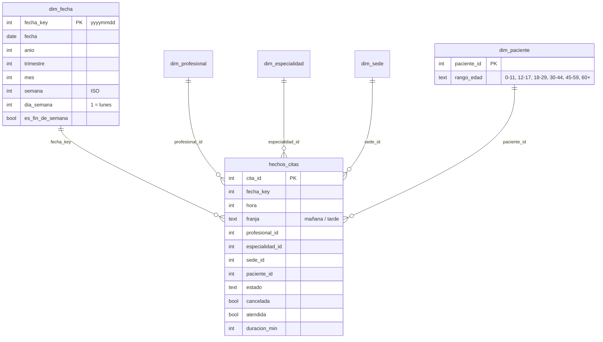

# Demo Hospital

[](https://github.com/JPS4L4/Demo-Hospital/actions/workflows/ci.yml)

Demo de un sitio web de hospital para mostrar un stack **Python + Angular**: una API REST en FastAPI con PostgreSQL y un frontend en Angular. Es un proyecto de demostración en construcción, no un sistema clínico real.

## Stack

- **Backend:** Python 3.12, FastAPI, SQLAlchemy 2, Alembic, PostgreSQL 16 (vía Docker Compose).
- **Frontend:** Angular 21, Tailwind CSS 4, Vitest.

## Estructura

```
.
├── docker-compose.yml   # PostgreSQL para desarrollo local
├── backend/             # API FastAPI
│   ├── app/             # core (config, base de datos), models, schemas, routers, services, analitica (SQL del modelo en estrella)
│   ├── alembic/         # migraciones
│   ├── tests/           # pytest (base hospital_test)
│   └── .env.example     # plantilla de variables de entorno
└── frontend/            # aplicación Angular (Meridiana: portada, noticias, sedes)
```

## Requisitos previos

| Herramienta | Versión | Para qué |
|-------------|---------|----------|
| Docker con Compose v2 (`docker compose`) | reciente | PostgreSQL 16 en un contenedor |
| Python | 3.12 | API (FastAPI) |
| Node.js y npm | Node 22 (LTS) | Frontend (Angular 21) |
| Git | cualquiera | Clonar el repositorio |

Puertos libres: `55432` (PostgreSQL), `8000` (API) y `4200` (frontend). PostgreSQL usa el `55432` y no el `5432` habitual para no chocar con uno que ya tengas instalado.

## Cómo arrancar

Desde cero, con un clon limpio. Los pasos 1 y 2 se hacen una sola vez; la API (paso 2) y el frontend (paso 3) quedan corriendo a la vez, cada uno en su terminal.

```bash
git clone https://github.com/JPS4L4/Demo-Hospital.git
cd Demo-Hospital
```

### 1. Base de datos

Desde la raíz del repositorio (PowerShell o bash):

```bash
docker compose up -d
docker compose ps      # espera a que la columna STATUS diga "healthy"
```

Levanta PostgreSQL en `localhost:55432` (base `hospital_db`, usuario y contraseña de desarrollo `hospital` / `hospital`). Los datos viven en un volumen de Docker y sobreviven a reinicios.

### 2. Backend

**Windows (PowerShell):**

```powershell
cd backend
python -m venv .venv
.venv\Scripts\Activate.ps1
pip install -r requirements.txt
Copy-Item .env.example .env
python -c "import re,secrets,pathlib; p=pathlib.Path('.env'); p.write_text(re.sub(r'(?m)^JWT_SECRET=.*', 'JWT_SECRET='+secrets.token_urlsafe(48), p.read_text(encoding='utf-8')), encoding='utf-8')"
alembic upgrade head
python -m app.seed
uvicorn app.main:app --reload
```

**Linux / macOS (bash):**

```bash
cd backend
python3.12 -m venv .venv
source .venv/bin/activate
pip install -r requirements.txt
cp .env.example .env
python -c "import re,secrets,pathlib; p=pathlib.Path('.env'); p.write_text(re.sub(r'(?m)^JWT_SECRET=.*', 'JWT_SECRET='+secrets.token_urlsafe(48), p.read_text(encoding='utf-8')), encoding='utf-8')"
alembic upgrade head
python -m app.seed
uvicorn app.main:app --reload
```

Qué hace cada paso:

- `.env.example` → `.env`: la plantilla ya apunta a la base del paso 1. El comando de Python escribe en `.env` un `JWT_SECRET` aleatorio, que es obligatorio (mínimo 32 caracteres): la API no arranca con el marcador de la plantilla. `.env` no se sube a git.
- `alembic upgrade head` crea las tablas y el schema de analítica.
- `python -m app.seed` carga sedes, noticias, profesionales, medicamentos, pacientes, ~12 meses de citas históricas y las cuentas demo; se puede repetir sin duplicar.
- `uvicorn` deja la API en <http://localhost:8000> (documentación interactiva en <http://localhost:8000/docs>). Comprueba que responde: `curl http://localhost:8000/health` (PowerShell: `Invoke-RestMethod http://localhost:8000/health`) devuelve `{"status":"ok"}`.

Los orígenes permitidos por CORS se configuran con `CORS_ORIGINS` (lista separada por comas; por defecto `http://localhost:4200`).

### 3. Frontend

En otra terminal, desde la raíz del repositorio:

```bash
cd frontend
npm ci
npm start
```

La aplicación queda en <http://localhost:4200>. La URL de la API está fija en `frontend/src/environments/environment.ts` (`http://localhost:8000`); si cambias el puerto de la API, cámbiala también ahí.

Para probarla entra con una de las [cuentas demo](#cuentas-demo): por ejemplo `admin@meridiana.example` / `Admin-Demo-2026` para ver el panel de administración y la analítica.

### Si algo falla

| Síntoma | Causa y solución |
|---------|------------------|
| `Bind for 0.0.0.0:55432 failed: port is already allocated` | Otro proceso usa ese puerto. Elige otro antes de levantar la base (PowerShell: `$env:POSTGRES_PORT = 55433`; bash: `export POSTGRES_PORT=55433`), ejecuta `docker compose up -d` y pon el mismo puerto en `DATABASE_URL` de `backend/.env`. Las variables `POSTGRES_USER`, `POSTGRES_PASSWORD` y `POSTGRES_DB` funcionan igual y también deben coincidir con `DATABASE_URL`. |
| La API no arranca y el error menciona `jwt_secret` (`Field required` o `String should have at least 32 characters`) | Falta `JWT_SECRET` en `backend/.env` o sigue el marcador de la plantilla. Repite el comando de Python del paso 2 desde `backend/`. |
| `connection refused` o `password authentication failed` al migrar o sembrar | La base aún no está `healthy` (mira `docker compose ps`), el puerto de `DATABASE_URL` no es el de `POSTGRES_PORT`, o el volumen conserva credenciales de una ejecución anterior: `docker compose down -v` borra el volumen y vuelve a empezar (borra los datos). |
| `Activate.ps1 cannot be loaded because running scripts is disabled` | En esa terminal: `Set-ExecutionPolicy -Scope Process Bypass` y vuelve a activar el entorno. |
| `npm ci` o `pip install` fallan por certificados detrás de un antivirus o proxy que inspecciona HTTPS | Para Node, `NODE_OPTIONS=--use-system-ca` (PowerShell: `$env:NODE_OPTIONS = "--use-system-ca"`). No desactives la verificación SSL. |
| El puerto 8000 o 4200 está ocupado | `uvicorn app.main:app --reload --port 8001` y `npm start -- --port 4201`; si cambias el de la API, actualiza `environment.ts` y, si cambias el del frontend, `CORS_ORIGINS`. |

## Endpoints disponibles

> Las lecturas del catálogo público (`GET` de sedes, noticias, especialidades, profesionales y medicamentos, y la disponibilidad) son abiertas. Todo lo demás exige sesión: ver [Autenticación y permisos](#autenticación-y-permisos).

### Convenciones

- **Errores:** `404` si el recurso no existe, `409` si choca con una regla de negocio o una restricción (duplicados, borrar algo en uso, agenda), `422` si los datos enviados no son válidos. El cuerpo es `{"detail": "..."}` (en español para `404`/`409` y los `422` de negocio) o la lista estándar de FastAPI para los `422` de validación de campos.
- **Listas paginadas** (especialidades, profesionales, medicamentos, pacientes, citas): aceptan `limit` (1–100, por defecto 20) y `offset` (≥ 0) y responden `{"items": [...], "total": N, "limit": 20, "offset": 0}`; `total` es el número de resultados sin paginar.
- **`/sedes` y `/noticias`** siguen devolviendo una **lista simple** (la usa el frontend); aceptan `limit` (1–200) y `offset` opcionales, y sin ellos devuelven todo.
- Las búsquedas `q` no distinguen mayúsculas de minúsculas (pero sí tildes).
- Las fechas con hora usan ISO 8601 con zona horaria.

### Recursos

Todos los recursos tienen `GET /recurso` (lista), `GET /recurso/{id}`, `POST /recurso` (201), `PUT /recurso/{id}` (reemplaza) y `DELETE /recurso/{id}` (204). Se explican solo las diferencias.

| Ruta | Lista: filtros | Notas |
|------|----------------|-------|
| `/health` | | Estado de la API (solo `GET`) |
| `/sedes` | `limit`, `offset` | No se puede borrar una sede con profesionales o citas (409) |
| `/noticias` | `limit`, `offset` | Más reciente primero |
| `/especialidades` | `q` (nombre) | Nombre único (409). No se borra con profesionales asociados (409) |
| `/profesionales` | `especialidad_id`, `sede_id`, `q` (nombres y apellidos), `activo` | Registro profesional único (409). Incluye `especialidad` y `sede` anidadas (`id`, `nombre`) |
| `/medicamentos` | `q` (nombre o principio activo), `requiere_formula` | `stock` ≥ 0 y `precio` ≥ 0 con 2 decimales; el precio sale como número |
| `/pacientes` | `q` (nombre, documento o correo) | `tipo_documento` ∈ `CC`, `TI`, `CE`, `PA`. Documento único por tipo y correo único (409). Correo válido, teléfono de 7 a 15 dígitos con `+` opcional, fecha de nacimiento pasada. No se borra con citas (409) |
| `/citas` | `paciente_id`, `profesional_id`, `estado` (`programada`, `cancelada`, `atendida`), `desde`, `hasta` | Incluye `paciente`, `profesional` y `sede` anidados. Ver reglas |
| `POST /citas/{id}/cancelar` | | Cancela la cita y libera el horario (idempotente; una cita atendida no se cancela: 409) |

`PUT /citas/{id}` (solo admin) acepta solo los campos que cambian (`paciente_id`, `profesional_id`, `sede_id`, `inicio`, `duracion_min`, `motivo`, `estado` = `programada`/`atendida`) y solo sobre citas programadas.

`GET /profesionales/{id}/disponibilidad?fecha=YYYY-MM-DD&duracion=30` (público) devuelve los huecos libres del día:

```json
{"profesional_id": 3, "fecha": "2026-10-19", "duracion_min": 30,
 "huecos": [{"inicio": "2026-10-19T07:00:00-05:00", "fin": "2026-10-19T07:30:00-05:00"}, "..."]}
```

- `fecha` es el día en hora de Bogotá; `duracion` ∈ 20, 30, 40, 60 (por defecto 30) y es también el paso entre huecos (con 40 min: 7:00, 7:40, 8:20…). Solo se ofrecen huecos cuya cita completa cabe antes de las 7:00 p. m.
- Se descartan los que se solapan con citas no canceladas del profesional y, si la fecha es hoy, los que ya pasaron.
- Fecha anterior a hoy → `422`; profesional inexistente → `404`. **Domingos, profesional inactivo o día ya agotado → lista vacía** (no es un error).
- Usa las mismas reglas que la reserva (`services/citas.py`): todo hueco ofrecido se puede reservar. No tiene en cuenta otras citas del mismo paciente (reservar sigue pudiendo dar `409` por solape del paciente).

## Analítica: OLTP y OLAP

La demo separa dos mundos dentro del **mismo PostgreSQL** (sin warehouse aparte, servidor de cubos ni ETL):

| | OLTP (operativo) | OLAP (analítico) |
|---|---|---|
| Schema | `public` | `analitica` |
| Para qué | Reservar, cancelar, consultar citas; datos normalizados y siempre al día | Responder preguntas agregadas ("¿cuántas citas por mes y especialidad?", "¿qué sede cancela más?") |
| Forma | Tablas con claves foráneas y restricciones (`citas`, `pacientes`, `profesionales`...) | **Esquema en estrella**: una tabla de hechos y cinco dimensiones, como vistas materializadas |
| Actualización | Cada petición escribe | Copia que se **refresca** (ver abajo); puede ir por detrás del OLTP |
| Acceso | La API de siempre | `/analitica/*`, solo administración |



- **Hechos:** `hechos_citas`, una fila por cita. **Dimensiones:** `dim_fecha` (un día por fila, sin huecos, con año/trimestre/mes/semana ISO/día de la semana en español), `dim_profesional`, `dim_especialidad`, `dim_sede` y `dim_paciente`.
- **Privacidad:** `dim_paciente` solo guarda el rango de edad (calculado al refrescar); nunca nombres, documentos ni correos.
- **Zona horaria:** fechas y horas se derivan en hora de Bogotá, igual que la agenda.
- **Dónde está el SQL:** un único módulo, `backend/app/analitica/sql.py`, lo usan la migración de Alembic (`f6a5c1d8b206`) y las pruebas (`create_all` no crea vistas materializadas). Cada vista tiene un índice único, requisito de `REFRESH MATERIALIZED VIEW CONCURRENTLY`. El schema no está en los modelos de SQLAlchemy y `alembic check` lo ignora.
- **Histórico sintético:** `python -m app.seed` genera además unos 12 meses de citas pasadas (≈4 400 citas y 320 pacientes ficticios, determinista) con lunes de más demanda, sábados flojos, pico de mañana, vacaciones de mitad y fin de año, especialidades más y menos populares y ≈12 % de cancelaciones. Las citas pasadas quedan `atendida` o `cancelada`. Se inserta directo con el ORM porque la API no permite crear citas en el pasado. El seed completo tarda un par de segundos.

### Cuándo se refresca

Las vistas materializadas son una copia: no se actualizan solas.

1. **Tras el seed** (`python -m app.seed`) y **tras el reinicio de la demo**: refresco normal dentro de la misma transacción que la carga (o quedan datos y analítica juntos o nada). Si la base se creó sin migrar y el schema no existe, se omite con un aviso en el registro.
2. **Bajo demanda:** `POST /analitica/refrescar` (admin) usa `REFRESH MATERIALIZED VIEW CONCURRENTLY`, que no bloquea las lecturas. Un *advisory lock* serializa refrescos simultáneos.
3. Las citas que se crean o cancelan por la API **no** aparecen en la analítica hasta el siguiente refresco; `GET /analitica/estado` lo indica (`actualizada: false`).

### Endpoints de analítica

Todos exigen sesión de **administrador** (`401` sin sesión, `403` para otro rol) y responden `503` si el schema `analitica` no existe (falta `alembic upgrade head`). Los días (`desde`, `hasta`) son inclusivos y en hora de Bogotá.

| Método y ruta | Descripción |
|---|---|
| `GET /analitica/resumen` | KPIs. Filtros: `desde`, `hasta`, `sede_id`, `especialidad_id` |
| `GET /analitica/citas` | Consulta agregada: `agrupar` (obligatorio, 1 o 2 dimensiones separadas por coma), `medida`, y filtros `desde`, `hasta`, `sede_id`, `especialidad_id`, `profesional_id`, `estado` |
| `GET /analitica/estado` | Último refresco y si la copia coincide con el OLTP |
| `POST /analitica/refrescar` | Refresca el modelo en estrella |

**Medidas** (`medida`, por defecto `total`): `total`, `canceladas`, `atendidas`, `tasa_cancelacion` (fracción 0-1) y `duracion_media` (minutos, solo citas no canceladas).

**Dimensiones** (`agrupar`): `fecha.anio`, `fecha.trimestre` (`2026-T1`), `fecha.mes` (`2026-03`), `fecha.semana` (`2026-S10`), `fecha.dia` (`2026-03-02`), `fecha.dia_semana` (`lunes`...), `franja` (`mañana`/`tarde`), `hora`, `especialidad`, `sede`, `profesional` y `paciente.rango_edad`. Los niveles de fecha incluyen a sus padres, así que subir o bajar de nivel nunca mezcla años. Cualquier otra dimensión o medida responde `422`; el SQL se arma solo con fragmentos de una lista blanca y los filtros van como parámetros enlazados.

Operaciones OLAP con estos parámetros:

- **Roll-up / drill-down:** cambia el nivel de fecha (`fecha.anio` → `fecha.trimestre` → `fecha.mes` → `fecha.dia`).
- **Slice / dice:** añade filtros (`sede_id=2`, `estado=cancelada`, `desde`/`hasta`).
- **Pivote:** dos dimensiones (`agrupar=fecha.mes,especialidad`).

```bash
# Citas por mes y especialidad, solo de una sede
curl -H "Authorization: Bearer $TOKEN" \
  "http://localhost:8000/analitica/citas?agrupar=fecha.mes,especialidad&sede_id=2"
```

```json
{"medida": "total", "agrupar": ["fecha.mes", "especialidad"],
 "filas": [{"dimensiones": {"fecha.mes": "2026-03", "especialidad": "Cardiología"}, "valor": 31},
           {"dimensiones": {"fecha.mes": "2026-03", "especialidad": "Pediatría"}, "valor": 44}]}
```

```bash
# Tasa de cancelación por día de la semana
curl -H "Authorization: Bearer $TOKEN" \
  "http://localhost:8000/analitica/citas?agrupar=fecha.dia_semana&medida=tasa_cancelacion"

# KPIs del último trimestre
curl -H "Authorization: Bearer $TOKEN" \
  "http://localhost:8000/analitica/resumen?desde=2026-07-01&hasta=2026-09-30"
```

```json
{"total": 1120, "atendidas": 985, "canceladas": 135, "programadas": 0,
 "tasa_cancelacion": 0.1205, "duracion_media_min": 31.4, "pacientes_distintos": 298}
```

`GET /analitica/estado` → `{"refrescado_en": "2026-10-15T19:41:21Z", "citas_oltp": 4452, "citas_analitica": 4452, "actualizada": true}`. `POST /analitica/refrescar` → `{"refrescado_en": "..."}`.

### Dashboard de analítica (frontend)

El panel de administración tiene la sección **Analítica** (`/admin/analitica`, solo admin), que consume estos endpoints:

- **Indicadores** (`/analitica/resumen`): citas, atendidas, tasa de cancelación, duración media y pacientes distintos.
- **Filtros** (slice/dice): periodo (3, 6 o 12 meses, o fechas propias), sede y especialidad; cada cambio repite todas las consultas.
- **Citas en el tiempo** con control de nivel de detalle (año → trimestre → mes → semana): es el roll-up/drill-down sobre `fecha.*`; muestra también las canceladas.
- **Demanda y cancelación por especialidad**, **citas por sede** y **horas pico** (mapa de calor día de la semana × hora, un pivote de dos dimensiones).
- **Frescura**: "Datos actualizados a…" con `/analitica/estado`, un aviso si la copia va por detrás del OLTP y un botón **Refrescar** (`POST /analitica/refrescar`). Si el schema `analitica` no existe (`503`) la página lo indica.

Los gráficos son SVG/HTML propios, sin librería de gráficos; cada uno tiene su equivalente en texto (valores en pantalla o tabla plegable) y funciona en claro y oscuro.

## Autenticación y permisos

Autenticación con **JWT** (HS256) en el encabezado `Authorization: Bearer <token>`. Las contraseñas se guardan con **Argon2id** (`pwdlib`).

| Ruta | Descripción |
|------|-------------|
| `POST /auth/registro` | Crea la ficha de paciente y su cuenta (rol `paciente`) en una sola transacción y abre sesión. Cuerpo: los campos de `POST /pacientes` más `password` (8 a 128 caracteres). El correo de la ficha es el de inicio de sesión. `201` con el mismo cuerpo que el login; `409` si el correo o el documento ya existen |
| `POST /auth/login` | Cuerpo JSON `{"email": "...", "password": "..."}` (el correo no distingue mayúsculas). `200` con `{"access_token", "token_type": "bearer", "expires_in": 3600, "usuario": {...}}`. Cualquier fallo (correo desconocido, contraseña errónea, cuenta desactivada) es `401` con el mismo mensaje `Correo o contraseña incorrectos` |
| `GET /auth/me` | Usuario en sesión: `{"id", "email", "rol", "activo", "paciente": {ficha} \| null}` (`paciente` es `null` para el admin) |
| `GET`/`PUT /pacientes/me` | Ficha del paciente en sesión (para el admin: `404`). Si cambia el correo, cambia también el de acceso |

En la documentación interactiva (`/docs`) pulsa **Authorize** y pega el `access_token`. El token expira a los `JWT_EXPIRE_MINUTES` (60 por defecto); no hay refresco: al expirar la API responde `401` y hay que volver a iniciar sesión.

**Errores:** `401` (`{"detail": ...}` con `WWW-Authenticate: Bearer`) si falta el token, es inválido o expiró, o la cuenta está desactivada; `403` si hay sesión pero el rol no alcanza (o el paciente pide datos de otro explícitamente); `404` si el paciente intenta ver o cancelar un recurso **ajeno** (se responde como si no existiera, para no revelar qué ids existen).

| Recurso | Anónimo | Paciente | Admin |
|---------|---------|----------|-------|
| `GET` sedes, noticias, especialidades, profesionales, medicamentos, `/profesionales/{id}/disponibilidad`, `/health` | sí | sí | sí |
| `POST`/`PUT`/`DELETE` de esos recursos | 401 | 403 | sí |
| `GET /pacientes`, `POST /pacientes`, `DELETE /pacientes/{id}` | 401 | 403 | sí |
| `GET`/`PUT /pacientes/{id}`, `/pacientes/me` | 401 | solo la propia (ajena: 404) | cualquiera |
| `GET /citas`, `GET /citas/{id}` | 401 | solo las propias (`?paciente_id=` ajeno: 403; cita ajena: 404) | todas |
| `POST /citas` | 401 | solo para sí (el `paciente_id` sale de la sesión y puede omitirse; si se envía otro: 403) | para cualquier paciente (`paciente_id` obligatorio) |
| `POST /citas/{id}/cancelar` | 401 | solo las propias (ajena: 404) | cualquiera |
| `PUT /citas/{id}` (reprogramar, marcar `atendida`), `DELETE /citas/{id}` | 401 | 403 | sí |

Borrar la ficha de un paciente (admin) borra también su cuenta.

### Cuentas demo

`python -m app.seed` crea (si no existen) dos cuentas **solo para el demo público**: no uses estas credenciales ni estos valores por defecto en ningún entorno real.

| Rol | Correo | Contraseña (variable) | Valor por defecto |
|-----|--------|-----------------------|-------------------|
| Admin | `admin@meridiana.example` | `DEMO_ADMIN_PASSWORD` | `Admin-Demo-2026` |
| Paciente (Paula Herrera, ficha del seed) | `paula.herrera@example.com` | `DEMO_PATIENT_PASSWORD` | `Paciente-Demo-2026` |

El seed no modifica una cuenta que ya existe (no restablece su contraseña). Cualquier paciente nuevo se crea desde `/auth/registro`.

### Reinicio periódico de la demo

Las credenciales de las cuentas demo son públicas, así que cualquiera puede crear o borrar datos. Para que el estropicio se deshaga solo, la API puede **reiniciar la base** cada cierto tiempo: vacía todas las tablas de datos (`TRUNCATE ... RESTART IDENTITY CASCADE`; `alembic_version` no se toca) y vuelve a ejecutar el seed, todo en una sola transacción, de modo que o queda como un seed recién hecho o no cambia nada. Las citas se generan otra vez relativas a la fecha del reinicio y las cuentas demo recuperan sus contraseñas por defecto.

- **Está desactivado por defecto**, porque borra todos los datos. Para activarlo en el despliegue del demo público define `DEMO_RESET_ENABLED=true` (y, si quieres, `DEMO_RESET_INTERVAL_HORAS`) en el entorno de la API. No lo actives en ningún entorno con datos reales.
- Se programa dentro de la propia API (tarea en segundo plano), sin cron ni servicios extra. El primer reinicio llega tras un intervalo completo, no al arrancar. Cada reinicio queda en el registro (`hecho` u `omitido`); si falla, se registra el error y se reintenta en el siguiente intervalo.
- Con varios workers o réplicas, todos programan el reinicio pero solo uno lo ejecuta: se coordinan con un *advisory lock* de PostgreSQL (`pg_try_advisory_xact_lock`) y los demás lo omiten.
- En local puedes lanzarlo a mano con un intervalo corto, p. ej. `DEMO_RESET_ENABLED=true DEMO_RESET_INTERVAL_HORAS=0.01`.
- La pantalla de ingreso avisa a quien visita la demo de que los datos se reinician periódicamente.

### Variables de entorno

| Variable | Obligatoria | Descripción |
|----------|-------------|-------------|
| `DATABASE_URL` | sí | Conexión a PostgreSQL |
| `JWT_SECRET` | sí | Secreto de firma de los tokens, mínimo 32 caracteres. `.env.example` trae un valor ficticio de desarrollo; en otros entornos genera uno propio (`python -c "import secrets; print(secrets.token_urlsafe(48))"`) |
| `JWT_EXPIRE_MINUTES` | no | Vigencia del token en minutos (60) |
| `CORS_ORIGINS` | no | Orígenes permitidos (`http://localhost:4200`) |
| `DEMO_ADMIN_PASSWORD`, `DEMO_PATIENT_PASSWORD` | no | Contraseñas de las cuentas demo del seed |
| `DEMO_RESET_ENABLED` | no | `true` activa el reinicio periódico de la demo (`false`) |
| `DEMO_RESET_INTERVAL_HORAS` | no | Horas entre reinicios, mayor que 0 (6) |
| `LOG_LEVEL` | no | Nivel de registro: `DEBUG`, `INFO`, `WARNING` o `ERROR` (`INFO`) |
| `RATE_LIMIT_ENABLED` | no | `false` desactiva el límite de intentos (`true`) |
| `RATE_LIMIT_LOGIN_POR_MINUTO` | no | Intentos por IP y minuto en `POST /auth/login` (10) |
| `RATE_LIMIT_REGISTRO_POR_MINUTO` | no | Intentos por IP y minuto en `POST /auth/registro` (5) |
| `TRUSTED_PROXY` | no | `true` solo si la API está detrás de un proxy de confianza que añade `X-Forwarded-For` (`false`) |

### Límite de intentos

`POST /auth/login` y `POST /auth/registro` (cada uno con su propio contador) admiten un número máximo de peticiones por IP y minuto, porque cada una cuesta un hash Argon2. Al superarlo responde `429` con `{"detail": "Demasiados intentos. Espera N segundos..."}` y la cabecera `Retry-After`. Cuentan todas las peticiones, correctas o no. El resto de la API no tiene límite.

- El contador vive en la memoria de cada proceso y se reinicia con él: con varios workers el límite efectivo se multiplica. Para una demo basta; en producción conviene un límite en el proxy o un almacén compartido.
- Con `TRUSTED_PROXY=false` (por defecto) se usa la IP de la conexión y se ignora `X-Forwarded-For`, que cualquiera puede falsear. Actívalo solo detrás de un proxy propio: entonces se toma la **última** IP del encabezado, la que añade ese proxy.

No implementado: recuperación de contraseña y verificación de correo.

### Salud del servicio

`GET /health` ejecuta `SELECT 1` en la base de datos: `200 {"status": "ok"}` si responde y `503 {"status": "error", "database": "no disponible"}` si no, para que un balanceador o monitor distinga una API viva de una API sin base de datos. El motor SQLAlchemy usa `pool_pre_ping` y `pool_recycle` (30 min) para no reutilizar conexiones cortadas. Los errores no controlados responden `500 {"detail": "Error interno del servidor"}` y quedan registrados con su traza; un error de integridad que ningún endpoint tradujo responde `409`.

### Reglas de las citas

Al crear o reprogramar una cita (`inicio` con zona horaria, `duracion_min` ∈ 20, 30, 40, 60 — por defecto 30):

- `inicio` debe ser futuro → `422`.
- La sede es la del profesional; si se envía `sede_id` debe coincidir → `422`.
- El profesional debe estar activo → `409`.
- Horario de atención: lunes a sábado, 7:00 a. m. a 7:00 p. m. (hora de Bogotá); la cita completa, incluida su duración, debe caber → `409`.
- `inicio` no puede estar a más de 365 días de anticipación → `422`.
- Sin solapes para el mismo profesional ni para el mismo paciente entre citas no canceladas → `409`. Cancelar una cita libera su horario.

**Sin dobles reservas, aunque falle el código.** Además de la validación de la API (que bloquea las filas del paciente y del profesional con `SELECT ... FOR UPDATE`), la base de datos tiene dos restricciones `EXCLUDE` (`ex_citas_profesional_solape` y `ex_citas_paciente_solape`, con `btree_gist`) que impiden que dos citas no canceladas del mismo profesional, o del mismo paciente, se solapen en el rango `[inicio, fin)`; citas contiguas sí caben. Si dos reservas simultáneas del mismo hueco llegan a la vez, una responde `201` y la otra `409`. La migración que las crea necesita `CREATE EXTENSION btree_gist` (en PostgreSQL 13+ es una extensión de confianza, así que basta ser dueño de la base) y falla si ya hay citas solapadas, que habría que corregir antes.

- `desde` / `hasta` (filtros) sin zona horaria se interpretan en hora de Bogotá.

El frontend consume esta API.
La URL de la API se define en `frontend/src/environments/environment.ts` (por defecto `http://localhost:8000`).

## Tests del backend

```bash
cd backend
pip install -r requirements.txt
pytest -q
```

Las pruebas usan una base PostgreSQL aparte, `hospital_test`, en el mismo servidor que `DATABASE_URL` (el contenedor del paso 1 debe estar arriba): se crea sola si no existe, sus tablas se generan al empezar y se vacían tras cada prueba, así que **nunca tocan los datos de desarrollo**. Si quieres otra, define `TEST_DATABASE_URL` (el nombre de la base debe terminar en `_test`). El usuario necesita permiso para crear bases de datos (el usuario de `docker-compose.yml` lo tiene).

## Lint y formato

Backend (desde `backend/`, con el entorno virtual activo; usa [ruff](https://docs.astral.sh/ruff/), configurado en `backend/pyproject.toml`):

```bash
ruff check .          # lint (añade --fix para corregir lo automático)
ruff format .         # formatea
ruff format --check . # solo comprueba el formato
```

Frontend (desde `frontend/`; ESLint con angular-eslint y Prettier):

```bash
npm run lint          # ESLint
npm run format        # Prettier, reescribe los archivos
npm run format:check  # Prettier, solo comprueba
```

### Migraciones

Las migraciones están en `backend/alembic/` (`alembic upgrade head` desde `backend/`). Tras cambiar un modelo, genera la migración con `alembic revision --autogenerate -m "..."` y revísala. `alembic check` falla si los modelos y las migraciones no coinciden. Limitación: Alembic no detecta las restricciones `EXCLUDE`, así que esas se mantienen a mano (modelo y migración). Tampoco ve el schema `analitica` (vistas materializadas): su SQL vive en `backend/app/analitica/sql.py` y lo usan la migración y las pruebas; si cambias el modelo en estrella, edita ese módulo y añade una migración nueva que lo recree (`DROP SCHEMA analitica CASCADE` y `CREAR`).

GitHub Actions (`.github/workflows/ci.yml`) ejecuta todo esto en cada push a `main` y en cada pull request: en el backend `ruff check`, `ruff format --check`, `alembic upgrade head` y `alembic check` (contra un PostgreSQL 16 como servicio, para comprobar que las migraciones aplican desde cero y no hay deriva) y `pytest`; en el frontend `npm run lint`, `npm run format:check`, `npm test` y `npm run build`.

## Hoja de ruta

- Páginas de profesionales y medicamentos en el frontend
- Login, reserva de citas y panel de administración en el frontend
- Despliegue